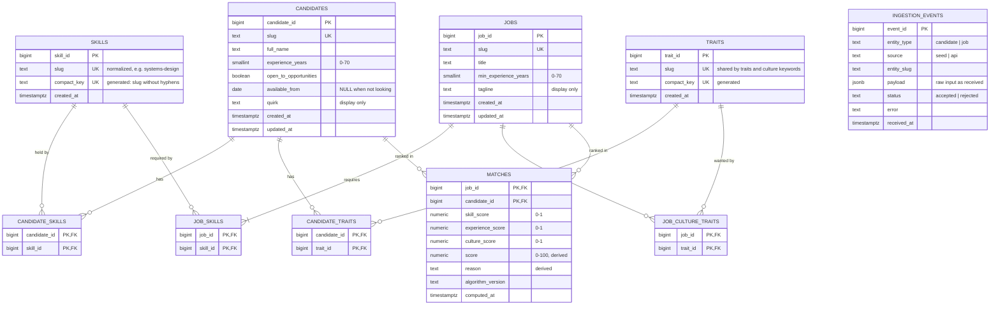

# Entity-Relationship Diagram

The schema in [`migrations/001_init.sql`](../migrations/001_init.sql), in third normal form (3NF). The diagram renders on GitHub.

## Reading the diagram

| Symbol | Meaning |
|---|---|
| `\|\|--o{` | one to zero-or-many |
| `\|\|--\|{` | one to one-or-many (a job has at least one required skill, enforced by the ingest code) |
| PK / FK / UK | primary key / foreign key / unique key |

## Normal form, table by table

| Table | Key | Form | Why |
|---|---|---|---|
| `skills`, `traits` | surrogate id; `slug` and `compact_key` are also unique | 3NF | `compact_key` depends on `slug`, which is itself a key, so it doesn't break 3NF. It's generated, so it can't drift. |
| `candidates`, `jobs` | surrogate id; `slug` is also unique | 3NF | Every column describes the candidate or job, and nothing else |
| `candidate_skills`, `candidate_traits`, `job_skills`, `job_culture_traits` | composite key | 3NF | Link tables with no other columns |
| `matches` | `(job_id, candidate_id)` | **Not 3NF, deliberately** | `score` and `reason` are derived from other tables. It's a cache of computed results, rebuilt on ingest, and `algorithm_version` records which formula produced each row. |
| `ingestion_events` | `event_id` | Log, outside the model | The raw JSON payload is kept exactly as received; nothing reads it for matching |

## Rules that live in the database

- **Availability is consistent:** `open_to_opportunities = false` requires `available_from IS NULL`, and `true` requires a date.
- **Slugs are well-formed:** lowercase words joined by single hyphens, enforced by `CHECK`.
- **No duplicate skills in different spellings:** `compact_key` is unique, so `team-building` and `teambuilding` can't both exist.
- **Skills in use can't be deleted:** link tables use `ON DELETE RESTRICT` on `skill_id` and `trait_id`. Deleting a candidate or job removes their links (`CASCADE`).
- **`updated_at` is always current:** set by a trigger, not by application code.
