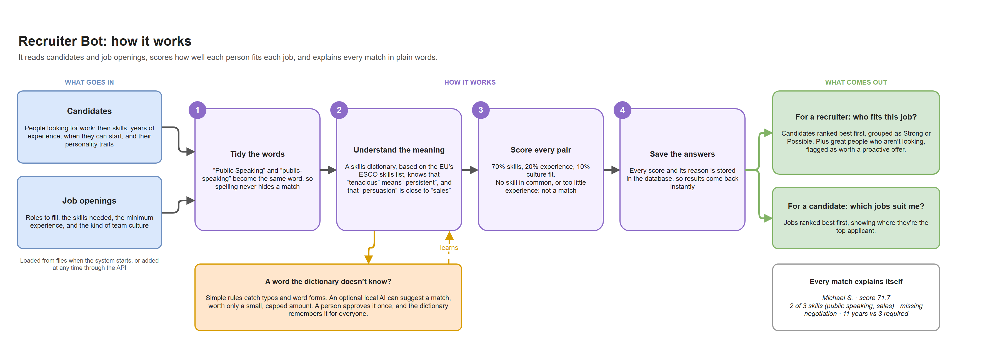
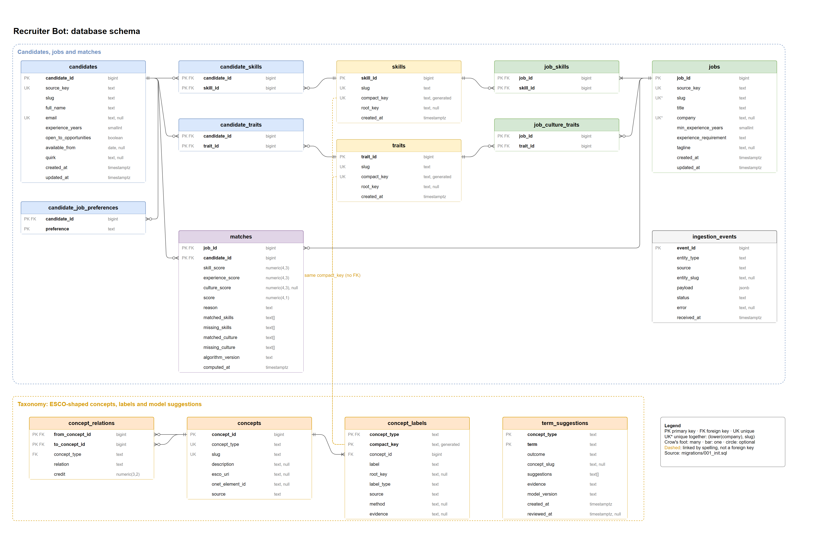

# Architecture and ER Diagram

## Architecture: how it works

What goes in, the four steps, and what comes out, in plain words.



The image is exported from [`architecture.drawio`](architecture.drawio).

## Entity-Relationship Diagram

The schema in [`migrations/001_init.sql`](../migrations/001_init.sql).



The image is exported from [`er_diagram.drawio`](er_diagram.drawio), which you can edit at [app.diagrams.net](https://app.diagrams.net) or in the draw.io VS Code extension. The same schema is below as a Mermaid diagram, which GitHub renders directly.

```mermaid
erDiagram
    SKILLS {
        bigint      skill_id     PK
        text        slug         UK "normalized, e.g. systems-design"
        text        compact_key  UK "generated: slug without hyphens"
        text        root_key        "groups unknown words"
        timestamptz created_at
    }
    TRAITS {
        bigint      trait_id     PK
        text        slug         UK "shared by traits and culture keywords"
        text        compact_key  UK "generated"
        text        root_key
        timestamptz created_at
    }
    CANDIDATES {
        bigint      candidate_id          PK
        text        source_key            UK "seed:<slug> or api:<random id>"
        text        slug                     "not unique: names can repeat"
        text        full_name
        text        email                 UK "optional identity"
        smallint    experience_years         "0-70"
        boolean     open_to_opportunities
        date        available_from           "NULL when not looking"
        text        quirk                    "display only"
        timestamptz created_at
        timestamptz updated_at
    }
    CANDIDATE_SKILLS {
        bigint candidate_id PK,FK
        bigint skill_id     PK,FK
    }
    CANDIDATE_TRAITS {
        bigint candidate_id PK,FK
        bigint trait_id     PK,FK
    }
    CANDIDATE_JOB_PREFERENCES {
        bigint candidate_id PK,FK
        text   preference   PK    "stored, not yet matched on"
    }
    JOBS {
        bigint      job_id                 PK
        text        source_key             UK
        text        slug                      "unique per company"
        text        title
        text        company                   "optional"
        smallint    min_experience_years      "0-70"
        text        experience_requirement    "required | preferred"
        text        tagline                   "display only"
        timestamptz created_at
        timestamptz updated_at
    }
    JOB_SKILLS {
        bigint job_id   PK,FK
        bigint skill_id PK,FK
    }
    JOB_CULTURE_TRAITS {
        bigint job_id   PK,FK
        bigint trait_id PK,FK
    }
    MATCHES {
        bigint      job_id            PK,FK
        bigint      candidate_id      PK,FK
        numeric     skill_score          "0-1"
        numeric     experience_score     "0-1"
        numeric     culture_score        "0-1, NULL without culture keywords"
        numeric     score                "0-100, derived"
        text        reason               "derived"
        text_array  matched_skills       "derived"
        text_array  missing_skills       "derived"
        text_array  matched_culture      "derived"
        text_array  missing_culture      "derived"
        text        algorithm_version
        timestamptz computed_at
    }
    INGESTION_EVENTS {
        bigint      event_id    PK
        text        entity_type    "candidate | job"
        text        source         "seed | api"
        text        entity_slug
        jsonb       payload        "raw input as received"
        text        status         "accepted | rejected"
        text        error
        timestamptz received_at
    }
    CONCEPTS {
        bigint concept_id      PK
        text   concept_type       "skill | trait"
        text   slug               "unique per type"
        text   description
        text   esco_uri
        text   onet_element_id
        text   source             "curated | auto"
    }
    CONCEPT_LABELS {
        text   concept_type  PK,FK
        text   compact_key   PK    "generated from label"
        bigint concept_id    FK
        text   label
        text   root_key
        text   label_type          "preferred | alternative | hidden"
        text   source              "curated | auto"
        text   method              "root_key | typo | group, for auto"
        text   evidence
    }
    CONCEPT_RELATIONS {
        bigint  from_concept_id PK,FK
        bigint  to_concept_id   PK,FK
        text    concept_type    FK
        text    relation           "related | unrelated"
        numeric credit             "0-1"
    }
    TERM_SUGGESTIONS {
        text        concept_type  PK
        text        term          PK "a skill or trait slug"
        text        outcome          "linked | review | approved | rejected"
        text        concept_slug     "for linked and approved"
        text_array  suggestions      "for review, best first"
        text        evidence
        text        model_version
        timestamptz created_at
        timestamptz reviewed_at      "for approved and rejected"
    }

    CANDIDATES ||--o{ CANDIDATE_SKILLS          : has
    SKILLS     ||--o{ CANDIDATE_SKILLS          : "held by"
    CANDIDATES ||--o{ CANDIDATE_TRAITS          : has
    TRAITS     ||--o{ CANDIDATE_TRAITS          : "describes"
    CANDIDATES ||--o{ CANDIDATE_JOB_PREFERENCES : prefers

    JOBS       ||--|{ JOB_SKILLS         : requires
    SKILLS     ||--o{ JOB_SKILLS         : "required by"
    JOBS       ||--o{ JOB_CULTURE_TRAITS : "looks for"
    TRAITS     ||--o{ JOB_CULTURE_TRAITS : "wanted by"

    JOBS       ||--o{ MATCHES            : "ranked in"
    CANDIDATES ||--o{ MATCHES            : "ranked in"

    CONCEPTS   ||--|{ CONCEPT_LABELS     : "named by"
    CONCEPTS   ||--o{ CONCEPT_RELATIONS  : from
    CONCEPTS   ||--o{ CONCEPT_RELATIONS  : to
```

Skills and traits connect to concepts by spelling, not by a foreign key: a word belongs to the concept whose label has the same `compact_key`. `term_suggestions` refers to words and concepts by slug in the same way.

### Reading the diagram

| Symbol | Meaning |
|---|---|
| `\|\|--o{` | one to zero-or-many |
| `\|\|--\|{` | one to one-or-many (a job has at least one required skill, enforced by the ingest code; a concept has its preferred label, checked by the loader) |
| PK / FK / UK | primary key / foreign key / unique key |
| `text_array` | Postgres `TEXT[]` |

### Normal form, table by table

| Table | Key | Form | Why |
|---|---|---|---|
| `skills`, `traits` | surrogate id; `slug` and `compact_key` are also unique | 3NF | `compact_key` depends on `slug`, which is itself a key, and it's generated, so it can't drift. `root_key` is also derived from `slug`, by the application. |
| `candidates` | surrogate id; `source_key` and `email` are also unique | 3NF | Every column describes the candidate, and nothing else |
| `jobs` | surrogate id; `source_key` and `(lower(company), slug)` are also unique | 3NF | Every column describes the job, and nothing else |
| `candidate_skills`, `candidate_traits`, `job_skills`, `job_culture_traits`, `candidate_job_preferences` | composite key | 3NF | Link tables with no other columns |
| `concepts` | surrogate id; `(concept_type, slug)` is also unique | 3NF | |
| `concept_labels` | `(concept_type, compact_key)` | 3NF | One concept per spelling within a type, so a word never means two things |
| `concept_relations` | `(from_concept_id, to_concept_id)` | 3NF | Symmetric relations are stored both ways, one directed row each |
| `matches` | `(job_id, candidate_id)` | **Not normalized, deliberately** | Scores, reason and the matched and missing lists are derived from other tables. It's a cache of computed results, rebuilt on ingest, and `algorithm_version` records which formula produced each row. |
| `term_suggestions` | `(concept_type, term)` | Stored output | The model stage's conclusions, plus a person's decision; `suggestions` is a ranked list kept as one value |
| `ingestion_events` | `event_id` | Log, outside the model | The raw JSON payload is kept exactly as received; nothing reads it for matching |

### Rules that live in the database

- **Availability is consistent:** `open_to_opportunities = false` requires `available_from IS NULL`, and `true` requires a date.
- **Slugs and labels are well-formed:** lowercase words joined by single hyphens, enforced by `CHECK`.
- **Emails are stored normalized:** lowercase, trimmed, with an `@`; unique when present.
- **One title per company:** `(lower(company), slug)` is unique; jobs without a company don't clash.
- **No duplicate skills in different spellings:** `compact_key` is unique, so `team-building` and `teambuilding` can't both exist.
- **Taxonomy stays within one type:** labels and relations reference `(concept_id, concept_type)`, so a skill concept can't get a trait label or relate to a trait. A concept has at most one preferred label and never relates to itself.
- **Automatic links say how they were made:** an `auto` label must name its `method`; a curated one can't.
- **Suggestions are consistent:** `concept_slug` is set exactly for `linked` and `approved`, and `reviewed_at` exactly for `approved` and `rejected`.
- **Skills in use can't be deleted:** link tables use `ON DELETE RESTRICT` on `skill_id` and `trait_id`. Deleting a candidate or job removes their links and matches (`CASCADE`).
- **`updated_at` is always current:** set by a trigger, not by application code.
