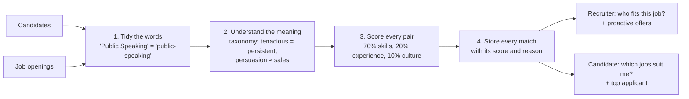
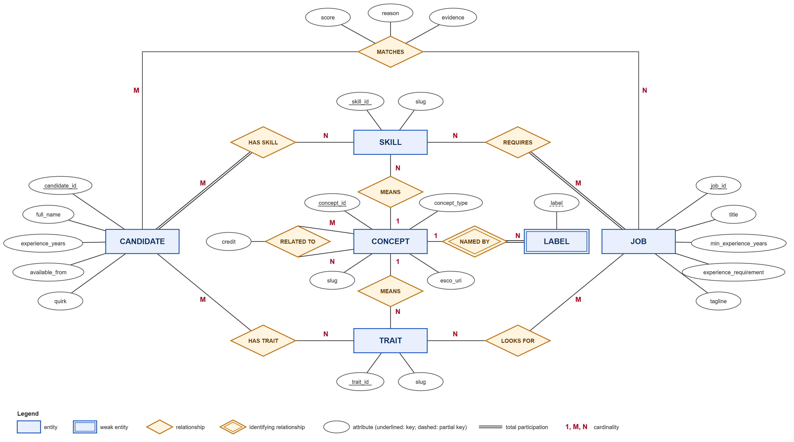

# Architecture and ER Diagram

## Architecture: how it works

Candidates and jobs are loaded from `seed/*.json` when the app starts, or added through `POST /candidates` and `POST /jobs`. Every write recomputes the affected matches in the same transaction, so reads are a single query.

| Step | Code |
|---|---|
| 1. Validate and normalize input, then store it | [`recruiter_bot/ingest.py`](../recruiter_bot/ingest.py) |
| 2. Load the taxonomy, and look up how much one word earns toward another | [`recruiter_bot/taxonomy.py`](../recruiter_bot/taxonomy.py) |
| 3. Score one candidate for one job (pure, no database) | [`recruiter_bot/matching/scorer.py`](../recruiter_bot/matching/scorer.py) |
| 4. Recompute, store and read matches | [`recruiter_bot/matching/store.py`](../recruiter_bot/matching/store.py) |
| What each side sees: tiers, proactive offers, ordering, evidence | [`recruiter_bot/matching/views.py`](../recruiter_bot/matching/views.py) |
| HTTP endpoints and response shapes | [`recruiter_bot/api/`](../recruiter_bot/api) |

## Entity-Relationship Diagram

### Conceptual model (Chen notation)

The entities, their relationships and cardinalities, drawn with the classic ER shapes: rectangles for entities, diamonds for relationships, ovals for attributes.

- A candidate **has** many skills and traits; a job **requires** many skills and **looks for** many traits (M:N). Double lines mean every candidate has at least one skill, and every job requires at least one.
- Each skill or trait word **means** at most one concept; a concept can be meant by many words (N:1).
- A concept is **named by** its labels. `LABEL` is a weak entity: a label exists only through its concept.
- A concept is **related to** other concepts (M:N), with a `credit` of 0.5.
- **Matches** is an M:N relationship between candidates and jobs that carries its own attributes: score, reason and evidence.

Editable source: [`er_diagram_chen.svg`](er_diagram_chen.svg).

### Physical schema (tables and columns)

The schema in [`migrations/001_init.sql`](../migrations/001_init.sql).

The image is rendered from the Mermaid source below, which GitHub also draws directly. To change the diagram, edit the source and re-export it.

```mermaid
erDiagram
    SKILLS {
        bigint skill_id     PK
        text   slug         UK "normalized, e.g. systems-design"
        bigint concept_id   FK "the meaning; NULL if unknown"
        text   concept_type FK "always skill"
    }
    TRAITS {
        bigint trait_id     PK
        text   slug         UK "shared by traits and culture keywords"
        bigint concept_id   FK "the meaning; NULL if unknown"
        text   concept_type FK "always trait"
    }
    CANDIDATES {
        bigint      candidate_id          PK
        text        full_name                "not unique: names can repeat"
        smallint    experience_years         "0-70"
        boolean     open_to_opportunities
        date        available_from           "NULL when not looking"
        text        quirk                    "display only"
        timestamptz created_at
    }
    CANDIDATE_SKILLS {
        bigint candidate_id PK,FK
        bigint skill_id     PK,FK
    }
    CANDIDATE_TRAITS {
        bigint candidate_id PK,FK
        bigint trait_id     PK,FK
    }
    JOBS {
        bigint      job_id                 PK
        text        title
        smallint    min_experience_years      "0-70"
        text        experience_requirement    "required | preferred"
        text        tagline                   "display only"
        timestamptz created_at
    }
    JOB_SKILLS {
        bigint job_id   PK,FK
        bigint skill_id PK,FK
    }
    JOB_CULTURE_TRAITS {
        bigint job_id   PK,FK
        bigint trait_id PK,FK
    }
    MATCHES {
        bigint      job_id            PK,FK
        bigint      candidate_id      PK,FK
        numeric     skill_score          "0-1"
        numeric     experience_score     "0-1"
        numeric     culture_score        "0-1, NULL without culture keywords"
        numeric     score                "0-100, derived"
        text        reason               "derived"
        text_array  matched_skills       "derived"
        text_array  missing_skills       "derived"
        text_array  matched_culture      "derived"
        text_array  missing_culture      "derived"
        timestamptz computed_at
    }
    CONCEPTS {
        bigint concept_id   PK
        text   concept_type    "skill | trait"
        text   slug            "unique per type"
        text   description
        text   esco_uri
    }
    CONCEPT_LABELS {
        text   concept_type  PK,FK
        text   label         PK
        text   compact_label UK "generated: label without hyphens"
        bigint concept_id    FK
    }
    CONCEPT_RELATIONS {
        bigint  from_concept_id PK,FK
        bigint  to_concept_id   PK,FK
        text    concept_type    FK
        numeric credit             "0.5 for related"
    }

    SEED_RUNS {
        text        filename  PK "a seed file already loaded"
        timestamptz loaded_at
    }

    CANDIDATES ||--o{ CANDIDATE_SKILLS   : has
    SKILLS     ||--o{ CANDIDATE_SKILLS   : "held by"
    CANDIDATES ||--o{ CANDIDATE_TRAITS   : has
    TRAITS     ||--o{ CANDIDATE_TRAITS   : describes

    JOBS       ||--|{ JOB_SKILLS         : requires
    SKILLS     ||--o{ JOB_SKILLS         : "required by"
    JOBS       ||--o{ JOB_CULTURE_TRAITS : "looks for"
    TRAITS     ||--o{ JOB_CULTURE_TRAITS : "wanted by"

    JOBS       ||--o{ MATCHES            : "ranked in"
    CANDIDATES ||--o{ MATCHES            : "ranked in"

    CONCEPTS   ||--|{ CONCEPT_LABELS     : "named by"
    CONCEPTS   ||--o{ CONCEPT_RELATIONS  : "from"
    CONCEPTS   ||--o{ CONCEPT_RELATIONS  : "to"
    CONCEPTS   |o--o{ SKILLS             : "meaning of"
    CONCEPTS   |o--o{ TRAITS             : "meaning of"
```

Every skill and trait word stores the concept it means. It's resolved once from `concept_labels` when the word is first stored (compared without hyphens, so `team-building` = `teambuilding`), and again whenever the taxonomy is reloaded. Matching reads only `concept_id`, so it never has to know which spelling a candidate or job used.

### Reading the diagram

| Symbol | Meaning |
|---|---|
| `\|\|--o{` | one to zero-or-many |
| `\|\|--\|{` | one to one-or-many (a job has at least one required skill, enforced on input; a concept has its preferred label) |
| PK / FK / UK | primary key / foreign key / unique key |
| `text_array` | Postgres `TEXT[]` |

### Normal form, table by table

| Table | Key | Form | Why |
|---|---|---|---|
| `skills`, `traits` | surrogate id; `slug` is also unique | 3NF | One row per normalized word. The concept is a fact about the word, so it's stored here once, not on every candidate's or job's link row. |
| `candidates`, `jobs` | surrogate id | 3NF | Every column describes the candidate or job, and nothing else. Names and titles aren't keys: they can repeat. |
| `candidate_skills`, `candidate_traits`, `job_skills`, `job_culture_traits` | composite key | 3NF | Link tables with no other columns |
| `concepts` | surrogate id; `(concept_type, slug)` is also unique | 3NF | |
| `concept_labels` | `(concept_type, label)`; `(concept_type, compact_label)` is also unique | 3NF | One concept per word within a type, so a word never means two things. `compact_label` is generated from `label`, so it can't drift. |
| `concept_relations` | `(from_concept_id, to_concept_id)` | 3NF | Symmetric relations are stored both ways, one directed row each |
| `matches` | `(job_id, candidate_id)` | **Not normalized, deliberately** | Scores, reason and the matched and missing lists are derived from other tables. It's a cache of computed results, rebuilt on every write. |
| `seed_runs` | `filename` | 3NF | Bookkeeping, like `schema_migrations`: which seed files are loaded. Not linked to other tables. |

### Rules that live in the database

- **Availability is consistent:** `open_to_opportunities = false` requires `available_from IS NULL`, and `true` requires a date.
- **Slugs and labels are well-formed:** lowercase words joined by single hyphens, enforced by `CHECK`.
- **Seeding twice adds nothing:** each seed file is recorded in `seed_runs` (its filename is the primary key) the first time it's loaded, and skipped after that. No record is identified by name.
- **One meaning per spelling, hyphens ignored:** `(concept_type, compact_label)` is unique, so `team-building` and `teambuilding` can't name two different concepts, and looking up a word can never find two.
- **Taxonomy stays within one type:** words, labels and relations reference `(concept_id, concept_type)`, so a skill word can't mean a trait concept, a skill concept can't get a trait label, and a skill can't relate to a trait. A concept never relates to itself.
- **Reloading the taxonomy can't leave a broken link:** deleting a concept sets the words' `concept_id` to NULL (`ON DELETE SET NULL`), and the reload then resolves every word again in the same transaction.
- **Skills in use can't be deleted:** link tables use `ON DELETE RESTRICT` on `skill_id` and `trait_id`. Deleting a candidate or job removes their links and matches (`CASCADE`).
